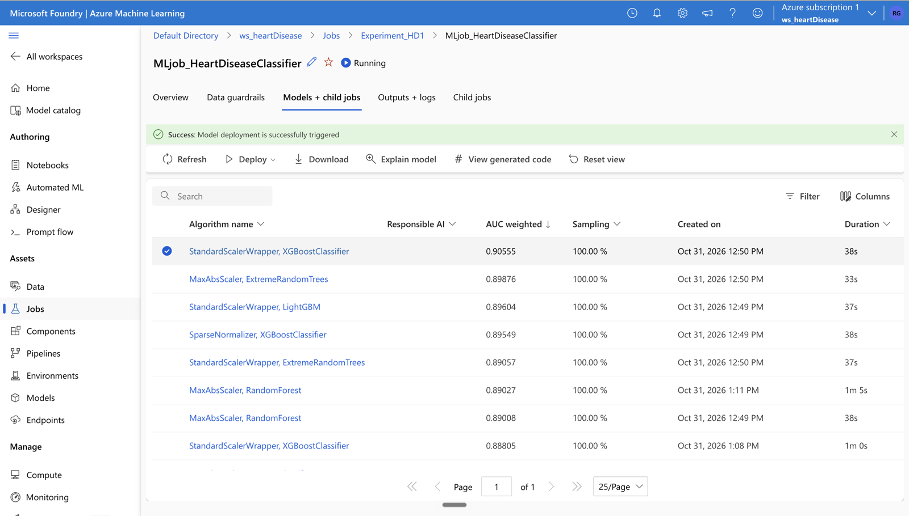
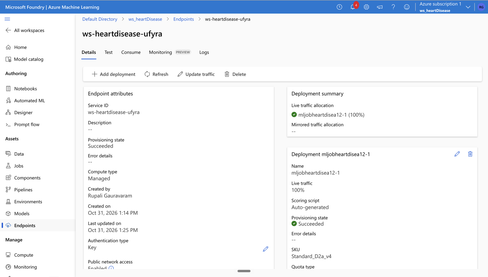

# Heart Disease Classification: AutoML model deployed as a real-time endpoint on Azure ML

## What it does 
Predicts whether a patient has **heart disease** (binary classification, `target` 1/0) from 13 clinical inputs: age, gender, chest pain type, resting blood pressure, cholesterol, fasting blood sugar, resting ECG, maximum heart rate, exercise-induced angina, oldpeak (ST depression), slope, number of major vessels and thalassemia.

## Pipeline

```
Resource group → Azure ML workspace (+ storage, key vault, App Insights, Log Analytics)
   → Data asset (CSV → MLTable)
   → Automated ML job (featurisation + scaler/algorithm search, ranked by the primary metric)
   → Registered model (MLflow format)
   → Managed online endpoint (key auth, auto-generated scoring script, 1 × Standard D2 v4 instance)
   → REST call from Python (JSON in, prediction out)
```

## Steps (all in Azure Machine Learning)
1. Created **Resource group** `rs_heartDisease` + **workspace** `ws_heartDisease`, with storage, key vault, Application Insights and Log Analytics.
2. **Data asset** `HeartDisease` (v1): **303 rows × 14 columns** (13 features + `target`).
3. **Automated ML classification job** `MLjob_HeartDiseaseClassifier` (Experiment_HD1), ranked by **weighted AUC**:
   - **Best: StandardScalerWrapper + XGBoostClassifier, AUC 0.906**
   - then MaxAbsScaler + ExtremeRandomTrees (0.899), StandardScalerWrapper + LightGBM (0.896), RandomForest (~0.890)
4. The best model was **deployed directly from the AutoML run** (MLflow format, scikit-learn 1.5.1).
5. **Managed online endpoint** `ws-heartdisease-ufyra` → deployment `mljobheartdisea12-1`, instance `Standard_D2a_v4` × 1, 100% of traffic, auto-generated scoring script, **key authentication**.

## Result
- Best weighted AUC **0.906** (0.5 = random guessing, 1.0 = perfect ranking).
- Endpoint consumed from Python: a sample patient (age 41, female, chest pain type 1, resting BP 130, cholesterol 204, max heart rate 172, oldpeak 1.4, slope 2, 0 major vessels, thalassemia 2) returned **1 (heart disease)**, which matches that row's label in the dataset.
- Endpoint status: deployment `mljobheartdisea12-1` **Succeeded**, 100% of traffic (screenshot 07).

## Compared with my hand-built model

I had built a heart-disease classifier by hand before: [Heart_Disease_Diagnostic](https://github.com/Rupali-Gauravaram/Heart_Disease_Diagnostic) (elastic-net logistic regression). On the same data:

| Model | ROC AUC | Recall (disease) |
|---|---|---|
| Hand-built elastic-net logistic regression (5-fold CV) | 0.891 ± 0.049 | 0.915 |
| Hand-built model, Monte Carlo CV (50 × 80/20) | 0.896 ± 0.030 | 0.883 |
| Azure AutoML best (XGBoost) | 0.906 (weighted AUC) | — |

The AutoML result sits within the fold-to-fold spread of the hand-built model (±0.03 to ±0.05), so on this 303-patient dataset the two are effectively tied.

## Files here
- `screenshots/` (7): AutoML child models (best selected, deployment triggered), the data asset (list + preview), endpoints, endpoint details.
- `model_artifacts.zip`: the deployed model (`model.pkl`, `MLmodel`, `conda.yaml`, `python_env.yaml`, `requirements.txt`).
- `deployment_consume.ipynb`: the notebook that called the live endpoint (URL and key replaced by environment variables; outputs kept).
- `consume_endpoint.py`: client code template (no key inside).

## Screenshots





## Author
**Rupali Gauravaram**: MSc Climate Resilience & Environmental Sustainability (University of Liverpool), Advanced Certification in Data Science & AI (IIT Roorkee - Intellipaat).
[LinkedIn](https://linkedin.com/in/rupali99) · [GitHub](https://github.com/Rupali-Gauravaram)
